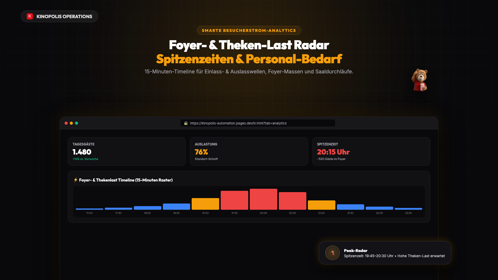
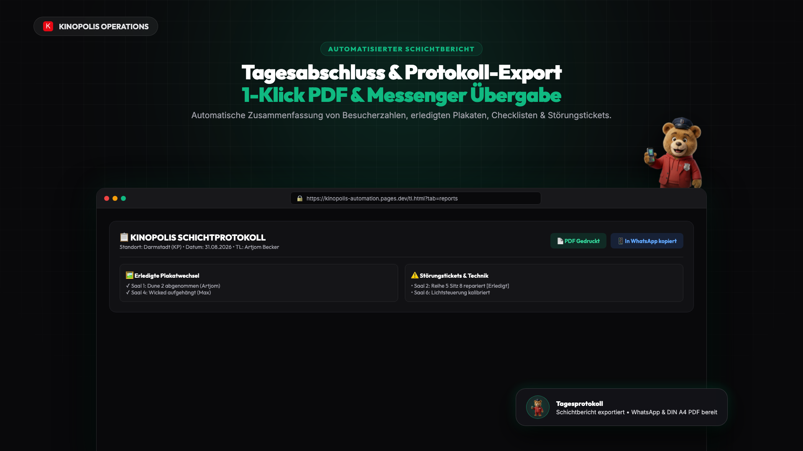
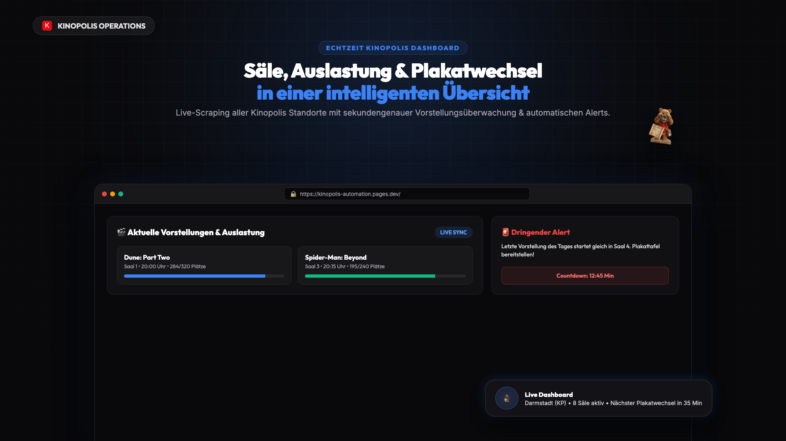
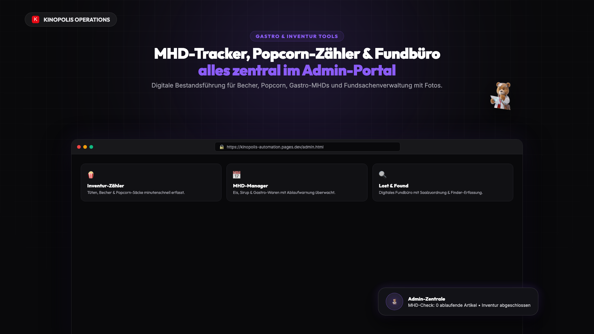
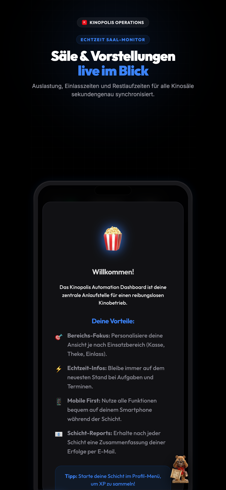
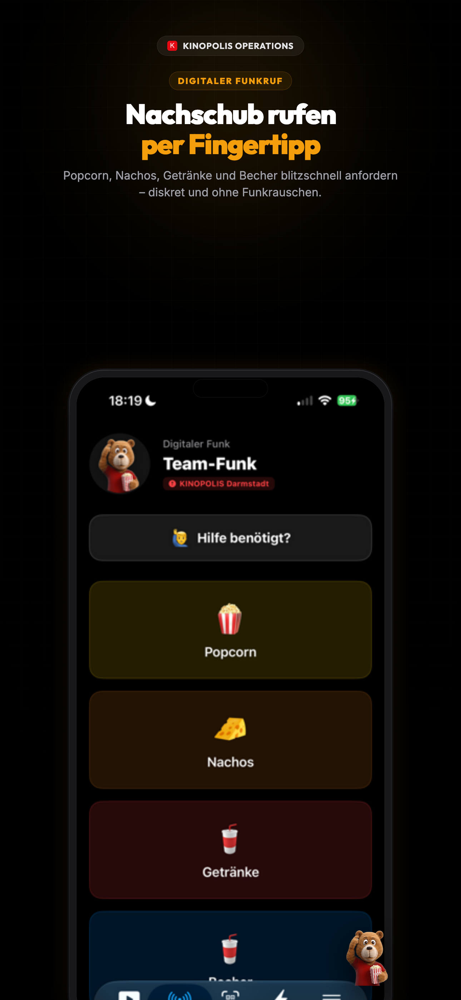
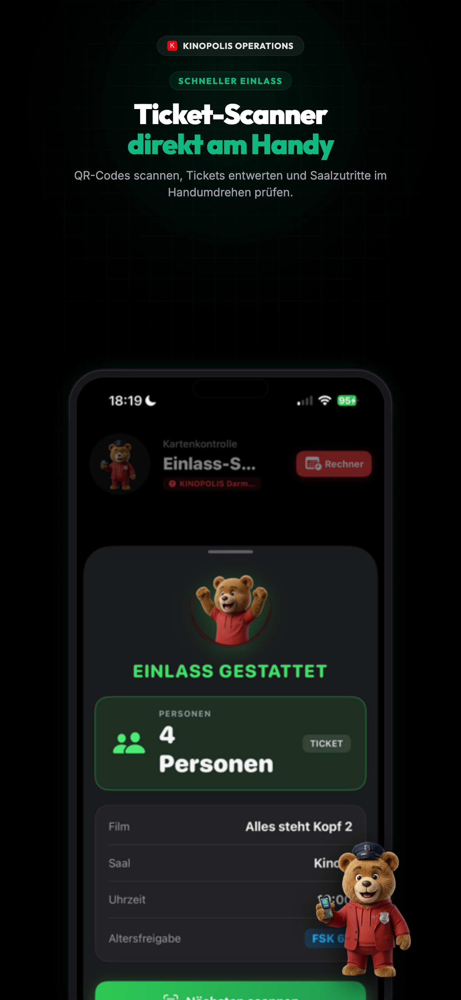
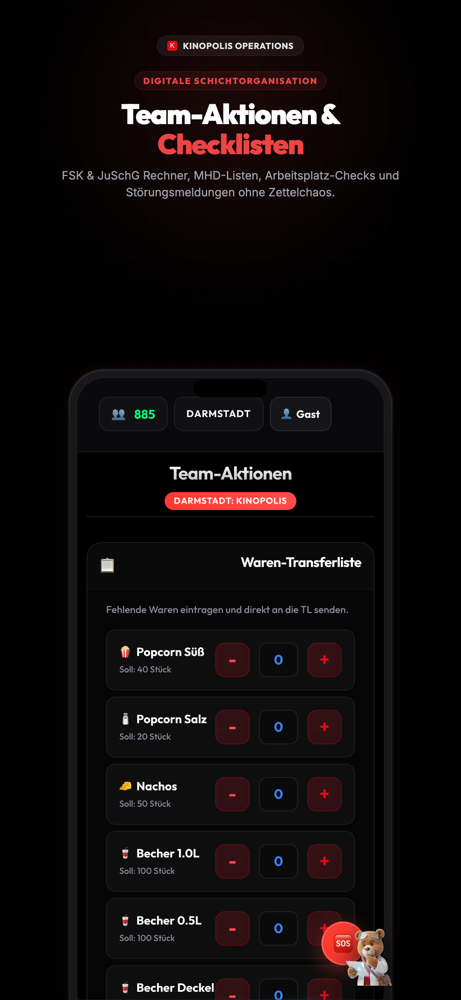
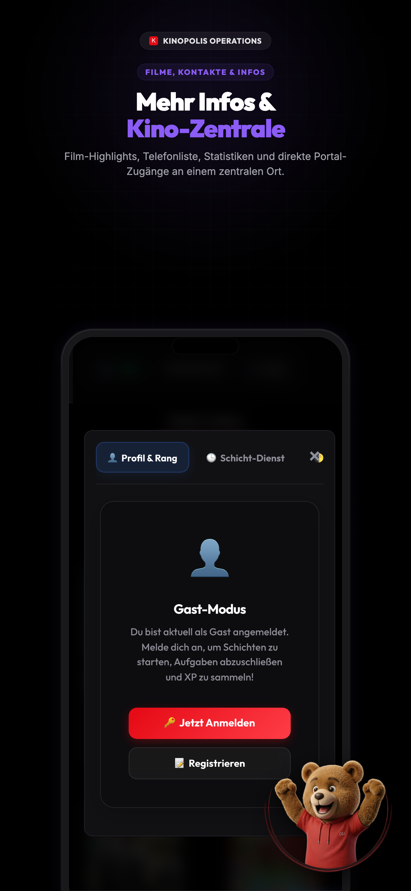

<p align="center">
  <a href="https://github.com/artjomartur/kinopolis-automation">
    
  </a>
</p>

<h1 align="center">Kinopolis Automation Suite</h1>

<p align="center">
  <strong>Next-Generation Kinobetriebs- &amp; Automations-Plattform</strong><br>
  Live-Saalüberwachung · Foyer- &amp; Peak-Radar · Automatisierte Schichtberichte · Digitaler Funk · Gastro-Inventur
</p>

<p align="center">
  <a href="https://github.com/artjomartur/kinopolis-automation/releases"></a>
  <a href="#"></a>
  <a href="https://workers.cloudflare.com/"></a>
  <a href="https://vitejs.dev/"></a>
  <a href="https://www.sqlite.org/"></a>
</p>

<p align="center">
  <a href="#-key-features">✨ Key Features</a> •
  <a href="#-desktop--tablet-showcase">🖥️ Desktop Dashboard</a> •
  <a href="#-mobile-app-ios--android--pwa">📱 Mobile App</a> •
  <a href="#-installation--schnellstart">🚀 Quickstart</a> •
  <a href="#-architektur--projektstruktur">🏗️ Architektur</a>
</p>

---

## 🚀 Was ist die Kinopolis Automation Suite?

Die **Kinopolis Automation Suite** digitalisiert den täglichen Kinobetrieb an Kinopolis-Standorten. Sie verbindet Live-Kinoinformationen, Saalüberwachung, Foyer-Besucherströme, Team-Kommunikation und Abrechnung in einem nahtlosen Ökosystem:

* **Nie wieder manuelle Sitzplatzprüfungen:** Direkte visuelle Kontrolle aller Säle, Belegungen und Pausen-Slots in Echtzeit.
* **Proaktive Foyer-Steuerung:** Genaue 15-Minuten-Vorhersagen für Einlass-Wellen (Süßwaren & Kassen) und Auslass-Wellen (Toiletten & Ausgang).
* **Schichtbericht in 1 Klick:** Druckfertiges DIN A4 PDF-Protokoll sowie Messenger-Exporte (WhatsApp / Telegram) auf Knopfdruck.
* **Team-Tools für die Hosentasche:** Digitaler Funkruf, blitzschneller Barcode-Scanner für Tickets, FSK-Jugendschutzrechner und digitales Fundbüro (Lost &amp; Found).

---

## 🖥️ Desktop & Tablet Showcase

Vollwertige Kommandozentrale für Schichtleiter, Theaterleiter und Admin-Teams:

| 📊 Smarte Foyer-Analytics | 📑 Automatisierter Schichtbericht |
| :---: | :---: |
|  |  |

| 🖥️ Echtzeit Saal-Monitor | 🍿 Gastro & Admin Inventur |
| :---: | :---: |
|  |  |

---

## 📱 Mobile App (iOS / Android / PWA)

Optimiert für native mobile Workflows auf iPhone, iPad und Android:

| 🖥️ Saal-Radar | 📻 Digitaler Funk | 🎟️ Ticket-Scanner | 🛡️ FSK-Rechner | 📋 Schicht & Fundbüro |
| :---: | :---: | :---: | :---: | :---: |
|  |  |  |  |  |

---

## ✨ Key Features im Überblick

### ⚡ 1. Live Saal- & Vorstellungs-Radar
* **Echtzeit-Sitzpläne:** Live-Scraping von Belegungsquoten und Sitzplatzverteilung.
* **Restlaufzeit-Tracking:** Minutengenaue Countdowns bis Filmende und Credits-Start.
* **Pausen-Erkennung:** Automatische Ermittlung von Reinigungsslots zwischen Vorstellungen.

### 📊 2. Smarte Foyer- & Besucherstrom-Analytics
* **15-Minuten-Zeitstrahl:** Visualisierung kommender Besucherwellen.
* **Spitzenzeiten-Erkennung:** Automatische Personal-Empfehlungen für Kassen, Einlass und Popcorntheke.
* **Wetter- & Trendeinfluss:** Kontextbezogene Foyer-Auslastungsanalyse.

### 📑 3. 1-Klick Schicht- & Tagesabschlussbericht
* **Druckoptimiertes DIN A4 PDF:** Professionelles Protokoll mit Kennzahlen, erledigten Plakaten, Störungstickets und Schichtleiter-Notizen.
* **Messenger-Übergabe:** 1-Klick-Formatierung für WhatsApp- und Telegram-Teamgruppen.

### 📻 4. Digitaler Funkruf & Push-Alerts
* **Schnellwahltasten:** Sofortige Benachrichtigung von Saaldienst, Einlasskontrolle, Service oder Technik.
* **Web-Push & Haptik:** Sofortige Vibration und Alerts auf Smartphones bei dringenden Ereignissen.

### 🍿 5. Gastro-Inventur & MHD-Tracker
* **Bestandserfassung:** Popcorn-Tüten und Becher-Zählung am Schichtende.
* **MHD-Warnsystem:** Automatisierte Überwachung von Mindesthaltbarkeitsdaten für Gastro-Waren, Eis und Getränke.

### 🔍 6. Digitales Fundbüro (Lost & Found)
* Erfassung gefundener Gegenstände mit Saalzuordnung, Foto-Upload, Fundort und Statusverfolgung (aufbewahrt, abgeholt, entsorgt).

### 🛡️ 7. JuSchG- & FSK-Rechner
* Exakter Jugendschutz-Rechner nach JuSchG: Sofortige Prüfung, ob minderjährige Gäste Vorstellungen nach 20:00, 22:00 oder 24:00 Uhr besuchen dürfen.

---

## 🛠️ Tech Stack & Architektur

```
┌─────────────────────────────────────────────────────────────┐
│                 KINOPOLIS OPERATIONS SUITE                  │
├──────────────────────────────┬──────────────────────────────┤
│  Frontend (Web & PWA)        │  Mobile App (Capacitor Native)│
│  • HTML5 & Vanilla CSS       │  • iOS Xcode Target          │
│  • ES Modules & Modern JS    │  • Haptic Feedback & Push    │
│  • Vite 8 Build Tool         │  • Offline-Fallback Cache    │
├──────────────────────────────┼──────────────────────────────┤
│  Cloudflare Edge Services    │  Lokales Node.js Backend     │
│  • Cloudflare Pages Worker   │  • Express 5 REST API        │
│  • Cloudflare D1 (SQLite)    │  • Cheerio HTML Scraping     │
│  • Web Push (AES-GCM/VAPID)  │  • DIN A4 Print Engine       │
└──────────────────────────────┴──────────────────────────────┘
```

---

## 💻 Installation & Schnellstart

### Voraussetzungen
* [Node.js](https://nodejs.org/) (Version 18 oder höher)
* npm (Version 9 oder höher)

### 1. Repository klonen & Abhängigkeiten installieren
```bash
git clone https://github.com/artjomartur/kinopolis-automation.git
cd kinopolis-automation
npm install
```

### 2. Entwicklungsserver starten

**Frontend via Vite starten:**
```bash
npm run dev
```

**Oder Fullstack (Frontend + lokales Node.js-Backend):**
```bash
npm run dev:node
```

Das Dashboard steht anschließend unter `http://localhost:5173` (bzw. `http://localhost:3001` für das Backend) bereit.

### 3. Production Build erstellen
```bash
npm run build
```

---

## 📁 Bereinigte Projektstruktur

```
kinopolis-automation/
├── assets/
│   ├── app-icon.png                  # Offizielles iOS Squircle App Icon (1024x1024)
│   ├── icon.png                      # App Icon Master
│   └── splash.png                    # Mobile Splash Screen
├── docs/
│   ├── Projektuebersicht.md          # Detaillierte Projektübersicht
│   └── Projektuebersicht.html        # HTML-Dokumentation
├── public/
│   ├── assets/
│   │   ├── appstore/                 # Mobile App Screenshots (iPhone 16 Pro Max)
│   │   ├── web_showcase/             # Desktop Web Showcase Slides (1920x1080)
│   │   └── Oli/                      # Maskottchen-Videos & Renderings
│   ├── oli-favicon.png               # Web Favicon
│   └── manifest.json                 # PWA Web App Manifest
├── src/
│   ├── index.html                    # Haupt-Dashboard (v1.1.0-beta)
│   ├── tl.html                       # Teamleiter Kommandozentrale
│   ├── admin.html                    # Admin- & Gastro-Portal
│   ├── style.css                     # Glassmorphism & Dark Mode Styling
│   ├── main.js                       # Frontend Controller & Live-Ticker
│   ├── auth.js                       # Rollenbasierte Authentifizierung
│   ├── core/                         # API-Client & Schnittstellen
│   ├── utils/                        # Datum-, Zeit- & UI-Helfer
│   └── components/                   # Foyer-Analytics & Reporting Engine
├── scripts/
│   ├── generate_appstore_screenshots.js # App Store Screenshot Generator
│   ├── generate_web_showcases.js     # Web Showcase Generator
│   ├── archive/                      # Archivierte Hilfsskripte
│   └── tests/                        # Integrationstests
├── server.js                         # Node.js / Express Server
├── _worker.js                        # Cloudflare Pages Worker Backend
├── schema.sql                        # Cloudflare D1 SQLite Datenbankschema
├── capacitor.config.json             # Capacitor Mobile Konfiguration
├── vite.config.js                    # Vite Build-Konfiguration
├── wrangler.jsonc                    # Cloudflare Wrangler Konfiguration
└── package.json                      # Version 1.1.0-beta
```

---

## 🏷️ Release Notes: v1.1.0-beta

* 🚀 **Offizieller Beta-Status:** Umstellung auf Version `v1.1.0-beta`.
* 🎨 **Neuer App Icon Hero:** Prominente Integration des iOS-Squircle-Icons in Web und README.
* 🧹 **Repository Cleanup:** Entfernung veralteter Patches, Archivierung loser Skripte und Löschung gemergter Feature-Branches.
* ⚡ **Performance:** Optimiertes Asset-Routing, reaktionsschnelleres Foyer-Radar und verbesserte PDF-Druckstile.

---

## ⚖️ Hinweis & Lizenz

*Dieses Projekt ist ein eigenständiges Betriebs- &amp; Automatisierungswerkzeug und steht in keinem offiziellen Zusammenhang mit der Kinopolis Management GmbH.*  
Lizenziert unter der [ISC Lizenz](package.json).
